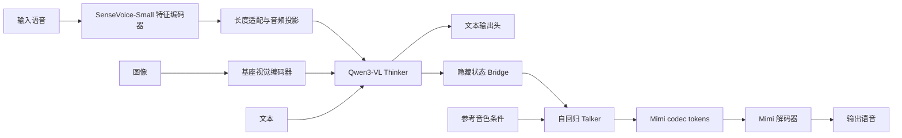

# Jaume Omni：端到端语音扩展方案

日期：2026-11-11。状态：架构与数据选型，尚未通过 NPU 音频组件验证，尚未启动 Omni 训练。

## 目标与边界

在 Qwen3-VL-2B-Instruct 或经核验的 Jaume-Vis checkpoint 上扩展语音输入、语音输出，保留文本、图像和结构化视觉能力。第一版做轮次式语音对话及看图语音问答，后续再增加流式与打断；不把具备 VAD 打断等同于完整全双工。

历史合成任务分数不作为该模型能力已经成立的证据。多个独立 checkpoint 的结果不能合并成单模型结果。

## 模型结构

SenseVoice 用作特征编码器，不先把识别文字当作唯一输入。输入特征维度、采样率、前处理与有效长度从实际 checkpoint 配置和实现核验，不硬编码照搬别人的 512 维。

MiniMind-O README 提供了可借鉴的 Thinker–Talker、隐藏状态 Bridge、Mimi 多码本预测设计。但其 Talker 维度和权重不能直接接 Qwen3-VL；投影、条件对齐、时序调度都需要适配。中间层优于末层是该项目的设计判断，不是所有基座上的通用结论。

第一版考虑单独的紧凑 Talker 与共享主干中的可训练适配层。多码本预测需明确码本间条件依赖、padding 和结束规则，不能只增加八个分类头就宣称已经正确实现。

## “端到端”如何验收

1. 推理链路：语音输入到语音输出由同一个模型包完成，不依赖外部 ASR 文本接口和独立文本 TTS 服务。
2. 联合训练：文本损失、语音码本损失作用于同一训练图；解冻阶段，语音损失能经连续 Bridge 回传到 Thinker 的可训练参数。检查梯度，不在 Bridge 意外 `detach`。
3. 冻结边界：初期冻结 SenseVoice、视觉塔和 Mimi 是可行工程选择，必须明确标注为冻结编码器/codec 的联合训练。离散 codec 索引和 argmax 不可自动微分；用目标音频编码得到的离散 codes 做交叉熵监督，不声称波形损失已贯穿全网。
4. 流式另验：SenseVoice 的整段编码不能自动变成严格因果流式编码。分块接口、历史缓存、未来信息依赖及延迟需要单独检查。第一版不承诺连续全双工。

主训练目标：`L = λ_text * CE_text + λ_audio * mean(CE_codebook)`。仅在回复区域计损失；每项按有效 token 独立归一化，避免语音序列长度无意压过文本。权重通过梯度与验证集确定。

## 已核实的数据起点

下表只列本次能直接读取官方说明的来源，未下载音频载荷。

| 来源 | 官方说明 | 用途与限制 |
| --- | --- | --- |
| [AISHELL-3](https://www.openslr.org/93/) | 约 85 小时、218 位普通话说话人；Apache-2.0；压缩包标注 19G | 中文多说话人 TTS 起点，不提供完整语音助手对话 |
| [LibriTTS-R](https://www.openslr.org/141/) | 约 585 小时英文朗读，24 kHz；CC BY 4.0；train_clean_100 包约 8.1G | 英文朗读与音质训练；保留归属声明，不能当中文对话数据 |
| [MiniMind-O 数据与说明](https://github.com/jingyaogong/minimind-o) | 提供 mini/full；mini 为英文且无视觉；README 指向 VoiceAssistant-400K、UltraChat-300K-SLAM-Omni 等来源，也使用合成音频 | 可借鉴训练样本结构；原始来源及合成音频条款仍需逐项核验，不把代码 Apache-2.0 自动套到全部数据 |

用户提供的 [KAN-TTS 数据](https://modelscope.cn/datasets/modelscope/DAMO.NLS.KAN-TTS.OpenDataset) 在此前读取的 README 中仅约半小时、379 条，适合流程验证或音色适配，不能承担通用语音能力训练。

Emilia、WenetSpeech4TTS 为扩量候选。本次网络超时，未核实数据卡、许可和实际可用分片，暂不写成已选训练集，也不自动全量下载。

建议先在服务器选取 20–50 小时、多个说话人的清洁语音做链路验证；该数值是预算起点，不是保证模型达标的规模。通过后逐步扩大到数百小时，并补充语音指令、图像语音问答和多轮语音数据。TTS 朗读小时数不能替代对话监督。

分割以说话人和源文档/原始录音为单位，先划分再切片；归一化文本、音频指纹去重。保留来源、许可、采样率、时长、说话人、语言、是否合成及生成器信息。音频流式读写、离线编码分片，禁止本机批量堆积波形。

## 分阶段实施

| 阶段 | 训练内容 | 放行条件 |
| --- | --- | --- |
| P0 环境与接口 | 隔离音频环境；SenseVoice 特征、Mimi 编解码、Qwen 隐藏状态与 Bridge 前后向 | 真实短音频可解码、有效长度正确、有限梯度、完整 checkpoint 重载一致 |
| P1 音频输入 | 冻结编码器，训练音频投影；以转写和语音指令监督对齐 | 未见说话人 CER/WER、语音问答；自由生成而非只测 teacher forcing |
| P2 语音输出 | 冻结 codec，训练 Talker/Bridge；使用匹配的文本音频对 | 自由生成无严重重复/截断，CER/WER、音色、自然度、实时率合格 |
| P3 联合 Omni SFT | 音频问答、图像+语音、多轮；混入纯文本与视觉数据；按显存选择 LoRA 或部分解冻 | 同一个重载 checkpoint 同时通过各模态留出集，检查旧能力回退 |
| P4 低延迟 | chunk 调度、缓存、VAD/轮次终止、打断 | 首音频延迟 p50/p95、持续实时率、打断停止延迟；独立验证输入流式性 |

初始 P3 采样预算可用：纯文本 25%、视觉文本 25%、语音输入文本回复 20%、文本/视觉输入语音回复 20%、音频输入语音回复 10%。这是按样本数的初始设置，应同时报告各模态的有效时长与 token 占比；没有验证结果前不称最优配比。

单张 Ascend 910B3 标称 64GB，可用于 2B 主干的适配训练探索。全参 Adam 状态、激活、视觉 token 和音频长度会显著占内存，不能由权重大小推断可训练 batch。先跑真实 optimizer step 测峰值；首版不依赖 CUDA-only FlashAttention、bitsandbytes 或未经验证的量化内核。

## 当前阻塞与可复现记录

2026-11-11 本次尝试：SSH 别名连接被关闭，隧道端口无监听。因此未确认远端数据生成是否完成，也未修改其环境或启动训练。此前环境记录的 torchaudio ABI 错误需现场复核；音频路径必须使用真实实现，禁止用 stub 掩盖。

本地工具 `tools/omni_source_check.py` 保存小型上游文档到 `logs/omni-sources/`，只抓说明与代码，不下载数据载荷。`tools/omni_env_probe.py` 用于远端只读诊断，输出依赖导入状态，不安装包、不下载模型、不执行训练。上游代码读取失败仍标为未审计，README 描述不等于代码验证。

## 2026-11-12 实验进展（已实际执行）

### 生成闭环

- `jaume/omni/model.py` 新增自回归 `generate_speech_codes()`，输出 Mimi codes `[B,T,K]`。
- `scripts/speak_omni.py` 完成 codes -> Mimi decode -> 24 kHz wav 的真实出声链路。
- 已验证：单条 64 帧生成 5.12 s 非静音音频；两个不同 speaker 的输出相关度仅 0.017，频谱质心分别为 1236.6 Hz / 1077.8 Hz，说明音色条件确实改变了输出，而非仅随机噪声。

### Talker KV cache

- 原生成路径每帧重跑全部前缀，复杂度 O(T^2)。
- 新增逐层 key/value 增量缓存 `_talker_forward_cached()`；保留 `use_kv_cache=False` 作为对照路径。
- 数值对齐（NPU 半精度）：最大绝对误差 2.75e-4。
- 性能（单卡 Ascend 910B3，batch=1）：

| 生成帧数 | 全量重算 | KV cache | 加速 |
| ---: | ---: | ---: | ---: |
| 32 | 1.00 s | 0.12 s | 8.55x |
| 64 | 2.12 s | 0.22 s | 9.55x |
| 128 | 4.88 s | 0.41 s | 11.84x |

- 复现脚本：`scripts/check_omni_kv_cache.py`。

### 音色条件正确性

发现并修复一个会影响结论的实质 bug：生成脚本曾从 `.pt` 特征文件重建 speaker 词表，必然得到空表并静默落到 speaker 0。现在训练 checkpoint 同时保存 `speaker_vocab.json`，训练、推理、评测共用同一映射；未知 speaker 会显式报错而不是静默选错人。

### 尚未完成 / 不应过度宣称

- 当前音色是 AISHELL-3 说话人闭集 embedding（158 人），不是音色克隆；零样本音色需要额外参考音频编码器。
- 尚未完成 CER/WER 语音可懂度评测；出声与非静音不等于发音正确。
- 文本损失仍使用 token 级 CE；没有独立的大型 TTS 主观听测集。
- KV cache 仅覆盖 Talker 解码；Thinker 的音频特征前向仍每轮执行一次。

## 2026-11-12 可懂度诊断与长训决策（已实际执行）

### 结论先行

新增架构（纯文本条件 + speaker embedding + 历史 codes）训练到 3000 步后，ASR 回环仍不可懂，但根因已定位为**训练量不足**，不是架构或评测链路错误。

### 证据链

1. **真实参考 codes 解码可识别**：直接用真实 Mimi codes 解码后，SenseVoice 正确转写“农村干群关系明显改善”，排除 codec/评测故障。
2. **3000 步自由生成 CER**：5 条验证样本 mean CER = 0.9857（单条 0.962–1.0）。
3. **teacher forcing token 准确率**：验证集 8.4%，训练集 9.9%，并非过拟合。
4. **16 条小样本过拟合探针**：同一套模型/损失
   - step 50：59.2%
   - step 100：94.5%
   - step 150：99.7%
   - step 200：100%
   证明代码路径、码本预测头、损失函数都具备学习能力。
5. **训练量核算**：3000 步 × batch 8 × grad-accum 2 = 384k 样本次，仅约 1.6 个 epoch（30000 条训练集）；欠拟合合理。

### 已执行的优化（均有实测）

| 项目 | 优化前 | 优化后 | 说明 |
| --- | --- | --- | --- |
| Thinker 前向 | 跑满 28 层 | 只跑到 bridge_layer=14 | TTS 不消费后续层，逐元素对比 max_abs_diff=0.0 |
| Thinker 反向 | 解冻 411.84M | 全冻结 | 解冻层在 bridge 之后，对 TTS loss 无梯度贡献 |
| 可训练参数 | 460.19M | 48.35M | 仅 adapter/bridge/talker/head |
| 训练吞吐（B=8，纯计算） | 3.8 samples/s | 93.6 samples/s | 约 24.6x |
| batch 64 纯计算吞吐 | — | 578.5 samples/s | 计算侧未见瓶颈 |
| 峰值显存 | 8.88 GiB | 约 6–8 GiB | 取决于 batch |

提前退出修复过程中的一个 bug：`hidden_states[k]` 是“跑完前 k 层”的输出，最初误写成前 k+1 层，导致 max_abs_diff=0.36；修正为 `layers[:bridge_layer]` 后精确为 0.0。

### 当前长训配置

- 输出：`/mnt/workspace/output/Jaume-omni-tts2-long`
- 起点：`/mnt/workspace/output/Jaume-omni-tts2/best`（step 3000）
- 目标步数：15000（绝对步数；实际新增 12000 步，约 25.6 个 epoch，batch 64）
- lr 1.5e-4，cosine，warmup 200，`min-lr-ratio 0.1`
- `num_workers=0`：服务器 `/dev/shm` 仅 64MB，多 worker + batch 64 会触发 bus error；单进程加载实测约 422 samples/s，够用
- 日志：`/mnt/workspace/log/jaume-omni-tts2-long/train.log`

### 待验证（不得提前宣称）

- 长训后 ASR 回环 CER 是否实质下降（目标先看是否 < 0.5，再谈可用）。
- 需要同时看 codebook 0 与其余码本的准确率：代码本 0 是语义本，若语义本明显优于其余，可考虑按码本加权或分阶段训练。
- 只有自由生成 CER 达标，才能说“可懂”；teacher forcing 指标仅作诊断。